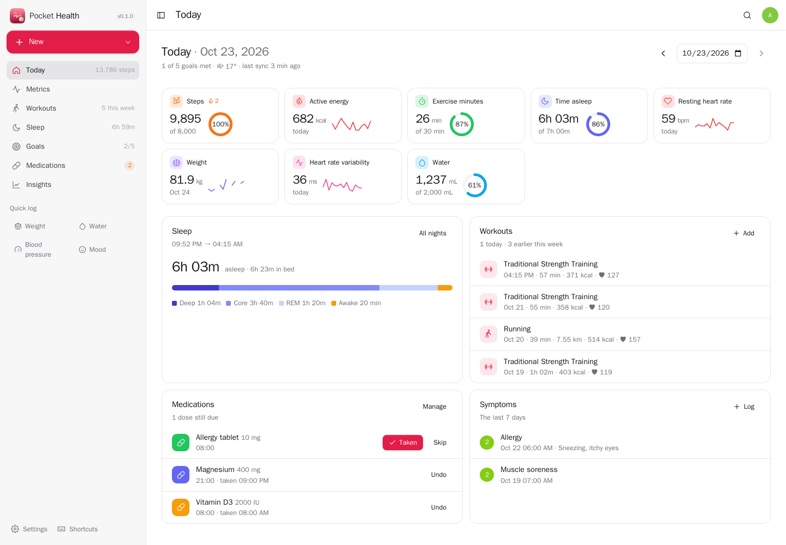
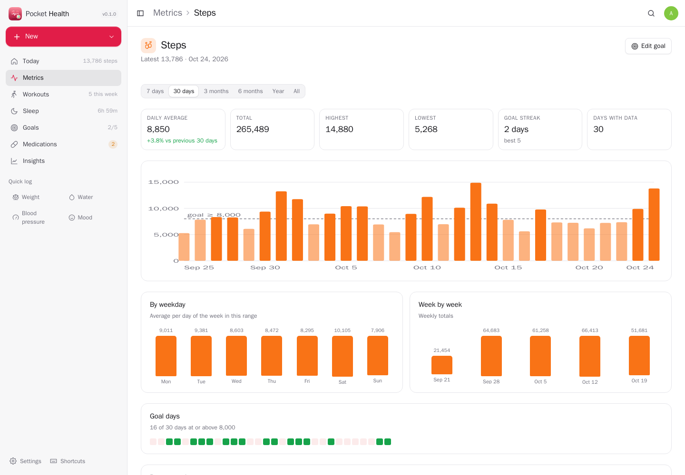
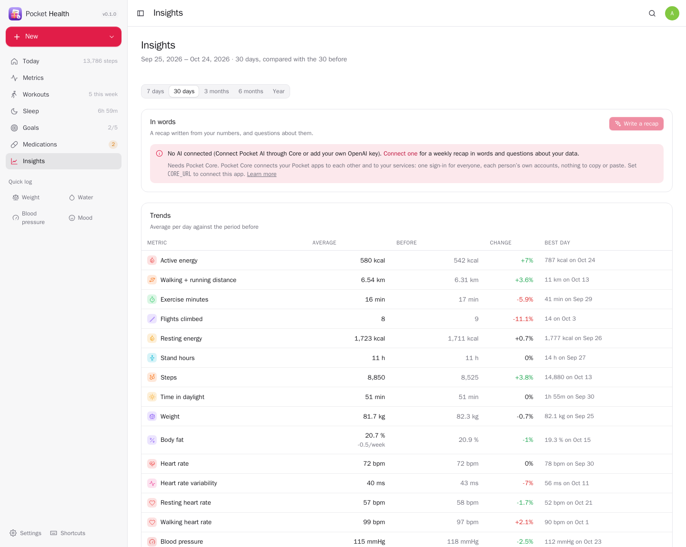
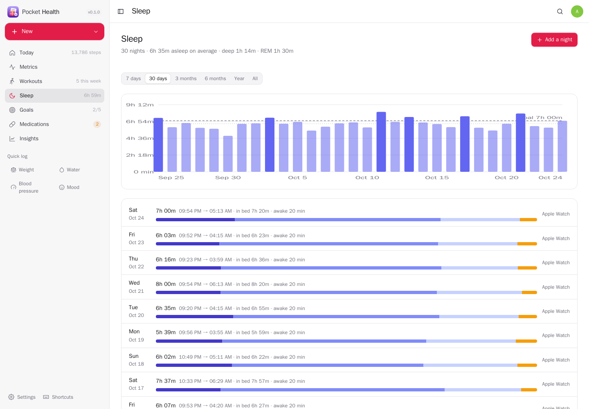
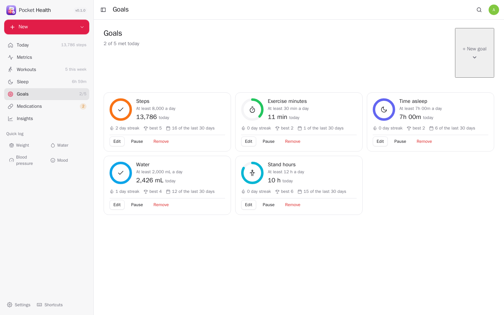
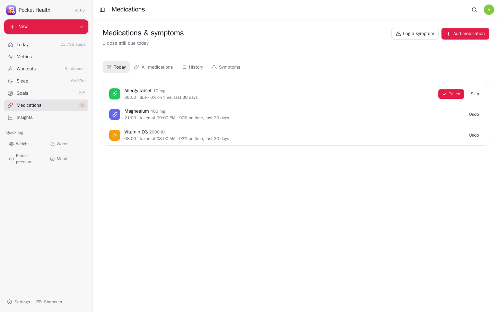
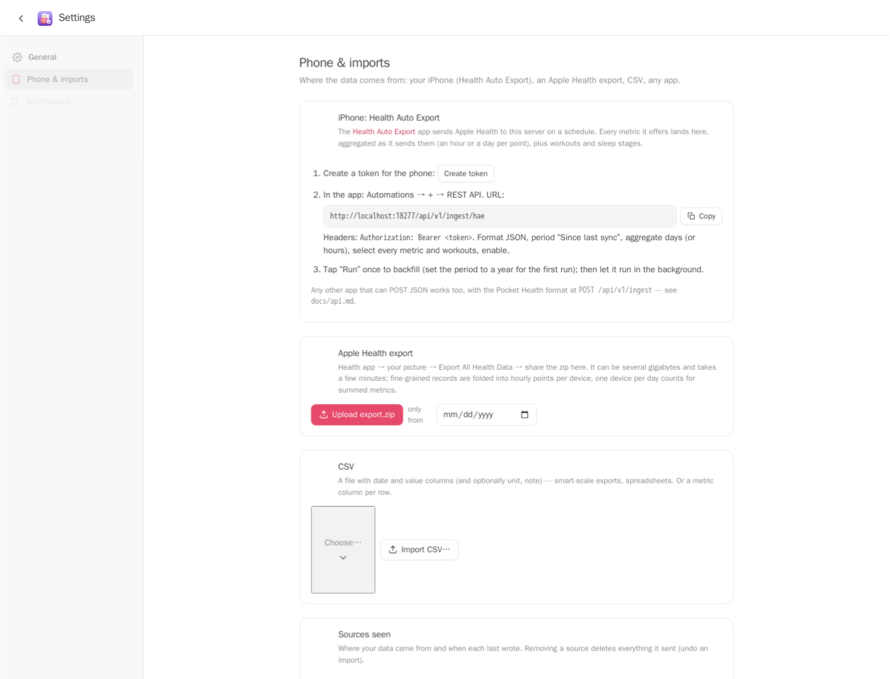
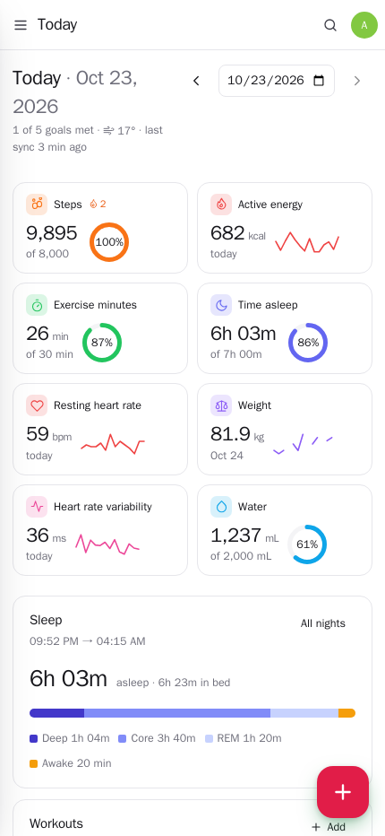
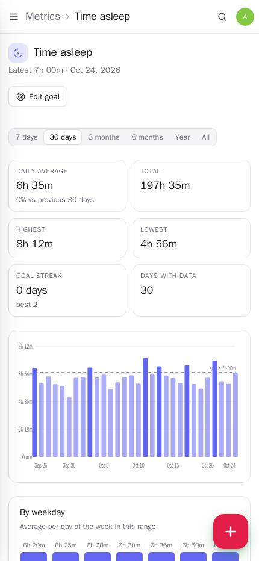

<p align="center"></p>
<h1 align="center">Pocket Health</h1>
<p align="center">Your health data at home. Everything your iPhone and watch record — steps, workouts, sleep stages, heart rate and HRV, weight and body fat, blood pressure, glucose, SpO₂, nutrition, mobility, hearing — lands on your own server, with a Health Auto Export automation or a one-time Apple Health export. Set daily goals with streaks, keep your medications with reminders and an adherence record, log symptoms, see trends, weekday patterns, how your days differ by the weather, and get a weekly recap in words. Pocket Day reads your day, Pocket Calendar shows your workouts, a run ticks your Pocket Habits habit.<br>One Go binary, one SQLite file, one volume. Part of the Pocket apps; works on its own too.</p>
<p align="center">
  <a href="https://github.com/abjelosevic88/pocket-homelab-health/actions"></a>
  <a href="https://github.com/abjelosevic88/pocket-homelab-health/pkgs/container/pocket-homelab-health"></a>
  <a href="LICENSE"></a>
</p>

---

<p align="center"></p>

<table>
  <tr>
    <td width="50%"></td>
    <td width="50%"></td>
  </tr>
  <tr>
    <td align="center"><sub>Every metric has a page: the chart with your goal, best and worst days, the weekday pattern, every reading.</sub></td>
    <td align="center"><sub>Insights: trends vs the period before, correlations between your days, weather, sleep regularity.</sub></td>
  </tr>
  <tr>
    <td width="50%"></td>
    <td width="50%"></td>
  </tr>
  <tr>
    <td align="center"><sub>Sleep: every night with its stages, against your goal.</sub></td>
    <td align="center"><sub>Goals: at least 8 000 steps, under 80 kg… with streaks and a push when reached.</sub></td>
  </tr>
  <tr>
    <td width="50%"></td>
    <td width="50%"></td>
  </tr>
  <tr>
    <td align="center"><sub>Medications: what is due, reminders, stock, adherence; symptoms next to them.</sub></td>
    <td align="center"><sub>Phone & imports: Health Auto Export in three steps, or the Apple Health export.zip.</sub></td>
  </tr>
</table>

<p align="center">
  &nbsp;&nbsp;
  
</p>

## What it does

- **Every metric, nothing dropped** — 80 catalogued metrics (activity, body, heart, vitals, sleep, nutrition, mobility and running form, mind, hearing) with canonical units (lb → kg, mi → km, °F → °C, mmol/L → mg/dL, fl oz → mL…), and anything unknown is kept under its own name. Each day is rolled up the right way: summed (steps, energy, water), averaged (heart rate, SpO₂), last reading (weight, VO₂ max).
- **From your phone** — the [Health Auto Export](https://apps.apple.com/app/health-auto-export-json-csv/id1115567069) app posts Apple Health to `POST /api/v1/ingest/hae` on a schedule: metrics with min/max, workouts with distance, energy and heart rate, sleep with stages. Re-sent windows update instead of doubling, so today's steps grow through the day.
- **Apple Health export** — upload `export.zip` (gigabytes are fine: it is parsed as a stream in the background). Fine-grained records are folded into hourly points per device; for summed metrics one device counts per day (your watch over your phone), so steps are not counted twice.
- **Any app, Shortcuts, scripts** — `POST /api/v1/ingest` in a plain JSON format, `POST /api/v1/samples` for one reading (“log a glass of water”), CSV import for scale exports and spreadsheets, and a Log dialog for weight, blood pressure, glucose, water, mood and more by hand.
- **Goals** — at least 8 000 steps, 30 minutes of exercise, 7 hours of sleep, 2 litres of water; at most 200 mg of caffeine, under 80 kg. Rings on Today, streaks, the days met on each metric's page, one push when a goal is reached.
- **Workouts and sleep** — every session with pace, heart rate, elevation and the weather it was in; nights with deep/core/REM/awake stages, bedtime regularity and a score.
- **Medications** — schedule (times, weekdays, from–until), reminders when a dose is due and not logged, taken/skipped with a log, stock that counts down, adherence over 30 days. **Symptoms** with severity and duration. Neither ever leaves the app through links.
- **Insights** — averages vs the period before, best and worst days, weight trend per week, weekday patterns, workouts by kind, sleep regularity, correlations between your days (sleep vs resting heart rate, caffeine vs sleep…), your days split by rain, temperature and condition (Open-Meteo, no key), goal rates. A **weekly recap in words** and questions about your data, through Pocket AI or your own OpenAI key — from a compact summary of your numbers, never a diagnosis.
- **Notifications** — goal reached, medication due, weekly report, a nudge when the phone stops syncing (Apprise, ntfy or any JSON webhook).
- Per person: everyone has their own data, goals, medications and connections; admins manage accounts, not content. Metric or imperial per person. Keyboard shortcuts, ⌘K, light/dark, phone layout, PWA, JSON and CSV export, Homepage widget endpoint.

## Run it

```sh
docker run -d --name pocket-health -p 8080:8080 -v ./data:/data \
  -e BASE_URL=https://health.example.com -e SECURE_COOKIES=true \
  ghcr.io/abjelosevic88/pocket-homelab-health:latest
```

or `docker compose up -d` with [docker-compose.yml](docker-compose.yml). Open it, create the first account, then Settings → Phone & imports. All options: [docs/configuration.md](docs/configuration.md). API: [docs/api.md](docs/api.md).

## With Pocket Core

Set `CORE_URL` and `CORE_REGISTRATION_KEY` and Health joins the box: people sign in with Pocket Core, phones paired with Core work right away, and a workout or a met goal ticks a habit in each person's own Pocket Habits through an app link — nothing to paste. Other Pocket apps can read your day (`health:read`: Pocket Day's journal, Pocket Calendar's overlay of workouts and nights) or record measurements (`health:write`: a kitchen app logging water and calories). Events on the bus: `health.workout_recorded`, `health.goal_reached`, `health.sleep_recorded`, `health.weight_recorded`, `health.medication_taken`, `health.symptom_logged`, `health.imported`. Without Core every connection can be made directly with a URL and an API token; the Core-only choices stay visible, greyed out.

## Develop

```sh
make dev     # API on :8080 with demo data + Vite on :5173
make test    # go vet, go test, tsc
make         # web + binary
```

MIT licensed. Not medical advice.
